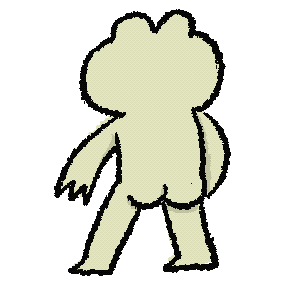

# 🐟 Desktop Mascot

Một linh vật (mascot) hoạt hình nhỏ sống trên màn hình Windows của bạn: chạy dọc thanh taskbar, nhảy múa khi rảnh, nhắc bạn uống nước, báo thức đúng giờ và trò chuyện với bạn nhờ AI (Google Gemini).

<p align="center">
  
  
  
  
</p>

## ✨ Tính năng

- **4 nhân vật**: 🦈 Sharkun, 🐳 Whaly, 🐟 Pinkun, 🐸 Frog. Mỗi nhân vật có bộ hoạt ảnh riêng (chạy, vẫy tay, ngủ, rơi, nhảy hiphop, tập gym, ghi chú, báo thức...).
- **Cửa sổ trong suốt, luôn nằm trên cùng**, đứng ngay trên taskbar.
- **Hành vi**:
  - 🐾 *Hoạt động tự do*: chạy qua lại dọc mép dưới màn hình.
  - 🧘 *Ngồi yên*: thỉnh thoảng (mỗi ~20 giây) tự nhảy một điệu ngẫu nhiên.
  - 💤 *Đi ngủ*: không làm phiền, tạm bỏ qua lời nhắc.
  - 🌐 *Chạy sang màn hình khác*: hỗ trợ nhiều màn hình.
- **Kéo thả**: kéo mascot đi bất kỳ đâu, thả ra sẽ rơi xuống taskbar.
- **Lời nhắc & báo thức**:
  - ⏱️ Nhắc theo chu kỳ (giây / phút / giờ), ví dụ "Uống nước thôi!".
  - ⏰ Báo thức theo giờ cố định (HH:mm), lặp lại mỗi ngày.
  - Hiện bong bóng lời thoại cạnh mascot trong khoảng thời gian tuỳ chỉnh.
- **Chat AI (Gemini)**:
  - Rê chuột vào mascot để hiện nút 💬 Chat nhanh.
  - Chọn vai trò xưng hô: 💕 Người yêu (Em – Iu), 💕 Người yêu (Anh – Iu), 💼 Trợ lý nghiêm túc.
  - AI có thể **tự thêm / xoá lời nhắc** qua function calling, ví dụ: *"Nhắc anh đi ngủ lúc 23:00"*, *"Xoá lời nhắc uống nước"*.
- **Đa ngôn ngữ**: 🇻🇳 Tiếng Việt và 🇯🇵 日本語.

## 📋 Yêu cầu

- Windows 10/11
- Python 3.10+
- Thư viện: `PySide6`, `google-genai`
- (Tuỳ chọn) API key Google Gemini để dùng tính năng chat

## 🚀 Cài đặt & chạy

```bash
git clone https://github.com/TinNguyenTCB/DesktopMascot.git
cd DesktopMascot

python -m venv .venv
.venv\Scripts\activate

pip install PySide6 google-genai
```

Thiết lập API key Gemini (chỉ cần nếu muốn chat với AI):

```powershell
# PowerShell – chỉ cho phiên hiện tại
$env:GEMINI_API_KEY = "your-api-key"

# Hoặc lưu vĩnh viễn cho tài khoản người dùng
setx GEMINI_API_KEY "your-api-key"
```

Chạy ứng dụng:

```bash
python main.py
```

Lần chạy đầu tiên sẽ hiện hộp thoại chọn **nhân vật**, **vai trò** và **ngôn ngữ**.

## 🖱️ Cách sử dụng

| Thao tác | Kết quả |
|---|---|
| Kéo chuột trái | Di chuyển mascot, thả ra để mascot rơi xuống |
| Rê chuột vào mascot | Hiện nút 💬 Chat nhanh |
| Chuột phải | Mở menu: Hành vi, Cài đặt nhân vật & ngôn ngữ, Quản lý lời nhắc, Trò chuyện, Thoát |

## ⚙️ Cấu hình

Ứng dụng lưu dữ liệu ở thư mục gốc dự án:

- `config.json` – nhân vật, vai trò, ngôn ngữ đang chọn và cờ `is_first_run`.
- `reminders.json` – danh sách lời nhắc / báo thức.

Ví dụ `config.json`:

```json
{
    "character": "🐟 Pinkun",
    "role": "💕 Người yêu (Em - Iu) / 恋人 (彼女)",
    "language": "🇻🇳 Tiếng Việt",
    "is_first_run": false
}
```

Đặt `is_first_run` thành `true` để hiện lại hộp thoại cài đặt ban đầu.

## 📦 Đóng gói thành file .exe

Dùng [PyInstaller](https://pyinstaller.org/):

```bash
pip install pyinstaller
pyinstaller main.spec
```

File chạy sẽ nằm trong `dist/`. Có thể tạo bộ cài đặt bằng [Inno Setup](https://jrsoftware.org/isinfo.php) với script `Setup.iss` (cần chỉnh lại đường dẫn `Source` cho phù hợp máy của bạn).

## 🗂️ Cấu trúc dự án

```
DesktopMascot/
├── main.py                 # Điểm khởi chạy
├── main.spec               # Cấu hình PyInstaller
├── Setup.iss               # Script Inno Setup tạo bộ cài
├── config.json             # Cấu hình người dùng
├── reminders.json          # Danh sách lời nhắc
├── icon.ico
├── assets/gifs/            # Hoạt ảnh nhân vật (tiền tố: W_ Whaly, P_ Pinkun, F_ Frog)
└── mascot_app/
    ├── window.py           # Cửa sổ mascot: di chuyển, vật lý rơi, menu, hẹn giờ
    ├── dialogs.py          # Chat, cài đặt, bong bóng lời thoại, quản lý lời nhắc
    ├── ai.py               # Kết nối Gemini + function calling cho lời nhắc
    ├── data.py             # Nhân vật, vai trò, chuỗi đa ngôn ngữ, đường dẫn tài nguyên
    └── utils.py            # Hàm tiện ích
```

## 🎨 Thêm nhân vật mới

1. Chuẩn bị bộ GIF với tiền tố riêng (ví dụ `X_`): `X_Run.gif`, `X_Wave.gif`, `X_Sleep.gif`, `X_Fall.gif`, `X_Note.gif`, `X_Alarm.gif`, `X_Gym.gif`, `X_Hiphop.gif`, `X_HappDance.gif`, `X_Ngao.gif`.
2. Đặt vào `assets/gifs/`.
3. Thêm một mục vào `CHARACTERS` trong [mascot_app/data.py](mascot_app/data.py):

```python
"🦊 Foxy": {
    "prefix": "X_",
    "name": "Foxy",
    "preview_gif": "X_Gym.gif",
    "y_offset": 0
}
```
